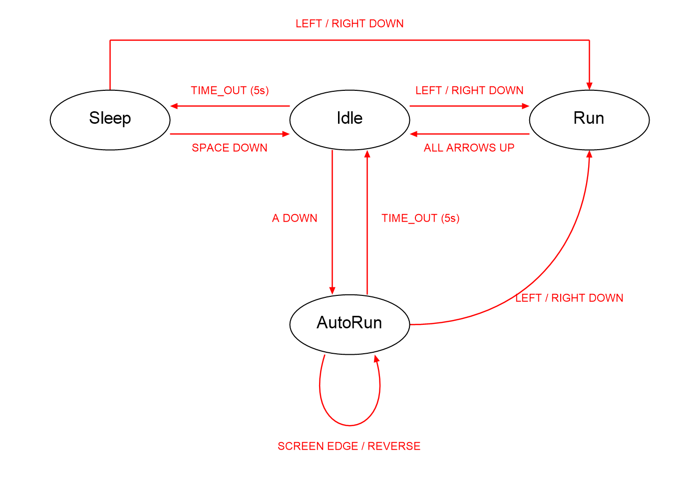

# Drill #11 — 소년 AutoRun

pico2d 소년에게 자동 무적 런 상태를 추가한 2D 게임 프로그래밍 실습입니다.

## 실행

Python 3가 설치된 Windows에서 다음 명령을 실행합니다.

```powershell
cd C:\Users\saenu\Desktop\code\2026-2DGP\Drill11
python -m pip install -r requirements.txt
python main.py
```

다른 경로에 clone했다면 해당 폴더에서 같은 명령을 실행하면 됩니다. 이미지 경로는 소스 기준이므로 IDE에서도 main.py를 실행할 수 있습니다.

## 조작과 상태

| 입력/조건 | 동작 |
| --- | --- |
| Idle에서 A | 5초 동안 AutoRun 시작 |
| 왼쪽/오른쪽 방향키 | 해당 방향으로 Run, AutoRun 중이면 즉시 취소 |
| 모든 방향키 해제 | Run에서 Idle로 전환 |
| AutoRun 중 화면 양끝 | 확대된 이미지 크기를 고려하여 자동 방향 반전 |
| AutoRun 5초 경과 | Idle 복귀, 원래 크기로 복원 |
| Idle 5초 경과 | Sleep 진입 |
| Sleep에서 Space | Idle 복귀 |
| Sleep에서 방향키 | Run 진입 |
| Esc / 창 닫기 | 종료 |

Run은 **200 px/s, 100×100**, AutoRun은 **400 px/s, 200×200**입니다. AutoRun은 진입 당시 바라보던 방향으로 시작합니다. 양쪽 방향키를 함께 누르면 마지막으로 누른 방향을 따르고, 이를 놓으면 남아 있는 방향을 따릅니다. A는 Idle에서만 동작하며 AutoRun 중 다시 눌러도 시간이 연장되지 않습니다.

## 상태도



편집용 원본: [state_diagram.svg](state_diagram.svg)

## 파일

- `boy.py`: Sleep, Idle, Run, **AutoRun** 클래스와 입력·애니메이션 처리
- `main.py`: 800×600 창, 경과 시간 기반 게임 루프, 종료 처리
- `animation_sheet.png`, `grass.png`: 실행에 필요한 수업 이미지
- `PRD.md`: 기획, 요구사항과 완료 기준
- `test_boy.py`: 시간·이동·반전·입력·그리기 크기 검증

이미지는 기존 수업 자료 `Labs/LEC12_CharacterController`에서 가져왔습니다. 기존 수면 동작을 유지하고 AutoRun을 추가했습니다. AI 개발 보조를 사용했습니다.

## 검증

```powershell
python -m unittest -v
```

창 없이 상태 전환과 이동량, 그리기 크기를 검사합니다. 실제 실행에서는 A를 누른 후 좌우 자동 반전과 5초 뒤 복귀를 확인하고, 다시 A를 누른 뒤 각 방향키로 취소해 봅니다.

## 제출

Public 저장소: https://github.com/sanu1227/2026-2DGP-Drill11

e-Class 제출 주소:

```text
https://github.com/sanu1227/2026-2DGP-Drill11.git
```

PRD, 기본 이동, AutoRun 구현, 검증 코드, 수면 상태, 요구사항 보완, 실행 안내, 상태도 추가를 실제 작업 순서대로 커밋했습니다. e-Class 제출 완료와 마감 시각은 별도로 확인해야 합니다.
